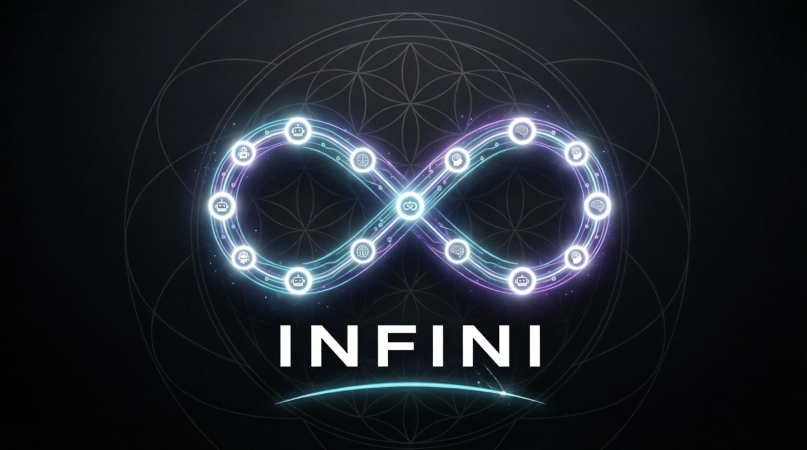

<picture>
  <source media="(prefers-color-scheme: dark)" srcset="assets/logo-dark.png">
  <source media="(prefers-color-scheme: light)" srcset="assets/logo-light.png">
  
</picture>

# INFINI — Portable Agent Workflow Spec & CLI

**Run the same agent workflow across execution engines, verify outputs against real constraints, and inspect or diff standardized execution traces.**

[](https://github.com/NickAiNYC/infini/actions)
[](tests/conformance/)
[](pyproject.toml)
[](LICENSE)

---

## What Problem This Solves

Every modern agent framework (LangGraph, CrewAI, AutoGen, custom orchestration) forces you to hardcode control flow, state schemas, and verification logic into proprietary runtimes. If you want to evaluate an alternative engine or compare how two runtimes execute the exact same task, you have to rewrite the workflow from scratch and parse incompatible log dumps.

**INFINI solves this by separating the workflow specification from the runtime engine.**
You define a workflow once in a declarative `Loopfile.yaml`. INFINI executes it on supported engines and produces deterministic, comparable traces (`run.json`) so you can diff where two engines diverge in step execution, cost, or verification.

---

## ⚡ 60-Second Quick Start

Requires Python 3.11+. Works out of the box from a clean clone with no external services or API keys:

```bash
# 1. Clone & install in a fresh virtualenv
git clone https://github.com/NickAiNYC/infini.git
cd infini
python3.11 -m venv venv
source venv/bin/activate
pip install -e .

# 2. Run the minimal working workflow (mock engine — zero API keys required)
infini run examples/quickstart.yaml

# 3. Inspect the execution trace
infini inspect runs/latest/

# 4. Time-travel replay from any step
infini replay runs/latest/ --step s1
```

Every run emits a structured `run.json` recording every step, cost, token count, and verification check.

---

## Honest Adapter & Engine Status

Every adapter in INFINI has exactly one honest status:
- **`working`**: Fully implemented end-to-end (mock and/or live execution, verification, trace generation).
- **`mock-only`**: Implements specification parsing, step translation, and mock execution with structured trace emission; live framework execution is not yet wired.
- **`not built`**: Manifest or stub only; CLI explicitly fails with a descriptive "not implemented" error.

| Engine / Adapter | Status | Type | Capabilities & Coverage |
| :--- | :---: | :--- | :--- |
| **Reference (`infini`)** | `working` | Built-in Engine | Canonical spec runtime. Mock and live execution, syntactic & semantic verification, time-travel replay, trace diff. |
| **LangGraph** | `mock-only` | Execution Adapter | StateGraph step mapping, mock execution, structured trace generation. Live LangGraph runtime execution not yet wired. |
| **Hermes** | `mock-only` | Governance Adapter | Policy verification and governance checks. 70.8% compatibility score (see [docs/scoring.md](docs/scoring.md)). |
| **OpenClaw** | `mock-only` | Execution Adapter | Agent step execution and tool manifests. 66.7% compatibility score (see [docs/scoring.md](docs/scoring.md)). |
| **Codemap** | `mock-only` | Context Adapter | Context-aware step routing and handoff artifact tracking. |
| **Local (llama.cpp)** | `mock-only` | Offline LLM | Trace simulation; live execution requires external llama.cpp binary and local model weights. |
| **CrewAI** | `not built` | Execution Adapter | Manifest only (`adapters/crewai/adapter.yaml`). CLI rejects with `not implemented`. |
| **AutoGen** | `not built` | Multi-Agent | Planned community adapter manifest (`adapters/`). CLI rejects with `not implemented`. |
| **Mastra** | `not built` | TypeScript | Planned community adapter manifest. CLI rejects with `not implemented`. |
| **Goose** | `not built` | Developer Agent | Planned community adapter manifest. CLI rejects with `not implemented`. |
| **OpenAI Agents SDK** | `not built` | Execution Adapter | Planned community adapter manifest (`adapters/codex/`). CLI rejects with `not implemented`. |

*(Note: Exploratory ideas like on-chain escrow payments, 50+ agent micro-benchmarks, and 3D graph UIs are archived in [docs/ideas.md](docs/ideas.md) until backed by reproducible benchmarks.)*

---

## Cross-Engine Portability & Trace Diff

Run the same Loopfile across supported engines and compare their execution traces:

```bash
# Execute on reference engine
infini run Loopfile.yaml --engine infini -o runs/reference

# Execute on LangGraph adapter
infini run Loopfile.yaml --engine langgraph -o runs/langgraph

# Diff the two traces to compare step progression and identify divergence
infini diff runs/reference/run.json runs/langgraph/run.json
```

---

## The Loopfile Specification

Workflows are declared in YAML. A minimal example ([`examples/quickstart.yaml`](examples/quickstart.yaml)):

```yaml
LOOPFILE: "1.0"
name: quickstart
version: 1.0.0
description: "Minimal 60-second portable agent workflow."

OBJECTIVE: "Generate project summary report and verify delivery."

AGENTS:
  - name: researcher
    role: researcher
    model_tier: haiku

STEPS:
  - id: s1
    name: analyze
    action: summarize_project
    uses: researcher
    produces:
      - report.md

VERIFY:
  syntactic:
    - "report.md:exists"
  semantic:
    - "judge:summary_quality>=80"
  confidence_threshold: 80

BUDGET:
  dollars: 1
  minutes: 5

STOP_WHEN:
  - all_verify_passed
```

Full specification reference: [`spec/loopfile-v1.md`](spec/loopfile-v1.md).

---

## Conformance & Certification

INFINI ships an automated conformance suite to ensure adapters adhere strictly to the specification.

Run the conformance suite:
```bash
infini conformance tests/conformance/ --mock
```

To certify an adapter and print its compatibility score:
```bash
infini certify adapters/hermes --mock
```
Compatibility scores (e.g. Hermes 70.8%, OpenClaw 66.7%) are computed as:
$$\text{Compatibility} = \left(\frac{\text{Supported Capabilities}}{12}\times 50\right) + \left(\frac{\text{Passed Conformance Tests}}{8}\times 50\right)$$
See [`docs/scoring.md`](docs/scoring.md) for the complete mathematical derivation and capability checklist.

---

## Project Readiness Audit

Audit your own repository for agent workflow readiness:
```bash
infini audit .
```
Evaluates 12 infrastructure signals (Loopfile, state tracking, verifiers, safety docs, CI workflows) and prints the exact score and formula.

---

## Status & Roadmap

Consolidated from historical status documents.

### Current Implementation Status
- **Core CLI & Spec Parser:** Stable. Schema validation against JSON Schema.
- **Reference Engine:** Working. Deterministic mock engine, budget enforcement, syntactic file checks, semantic judge checks, and time-travel replay.
- **Adapters:** 1 reference engine working (`infini`), 5 mock-only adapters (`langgraph`, `hermes`, `openclaw`, `codemap`, `local`), 5 not built (`crewai`, `autogen`, `mastra`, `goose`, `openai-agents`).
- **Memory & Storage:** Embedded SQLite with FTS5 for local run memory and state persistence.
- **Conformance Suite:** 8/8 tests passing (`tests/conformance/`).

### Active Roadmap
1. **Standards-Based Traces (v0.2.0):** OpenTelemetry GenAI semantic conventions export and step-level trace divergence diffing.
2. **Offline Trace Signing:** Local Ed25519 signing of canonical trace hashes for offline verification.
3. **External Runtime Adapters:** Upgrading `langgraph` adapter from mock-only to live execution via LangGraph Python SDK.
4. **CI Enforcement:** Standalone GitHub Action (`infini-guard`) running conformance and audit checks on pull requests.

---

## Honest Limitations

1. **Mock-first ecosystem:** Outside the reference engine, adapter execution is currently `mock-only` (simulates steps and validates Loopfile translation) rather than driving live third-party runtime graphs.
2. **Single-node runtime:** The orchestration engine runs as a single local process using embedded SQLite. There is no distributed coordinator or multi-tenant isolation.
3. **Syntactic file checks:** Real filesystem checks (`file:exists`, `file:valid_json`) run within the local process working directory; containerized sandboxing is not yet implemented.

---

## Development & Testing

```bash
# Run unit tests
python -m pytest cli/tests/ -v

# Run conformance suite
infini conformance tests/conformance/ --mock

# Run adapter certifications
infini certify adapters/hermes --mock
infini certify adapters/openclaw --mock
```

[Contributing Guide](CONTRIBUTING.md) · [Scoring Methodology](docs/scoring.md) · [Ideas Archive](docs/ideas.md) · [License: MIT](LICENSE)
