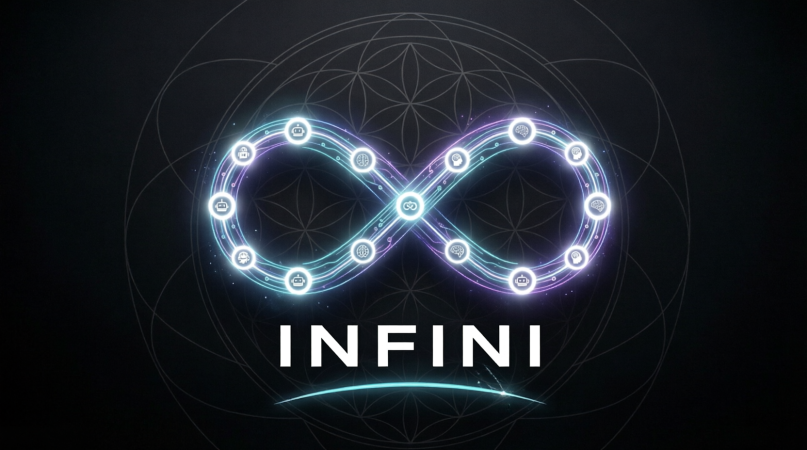
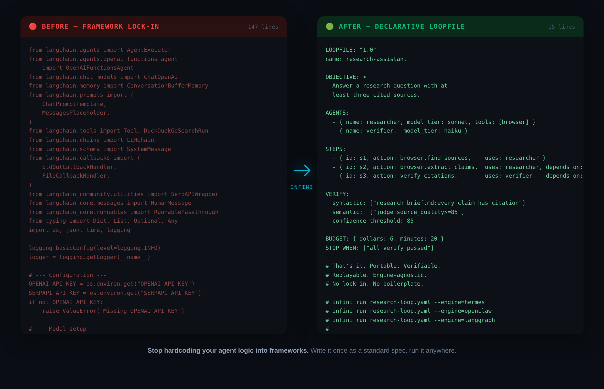
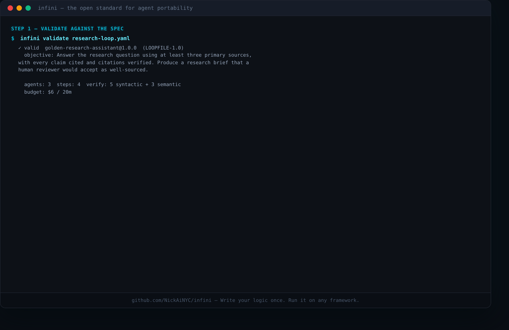

<picture>
  <source media="(prefers-color-scheme: dark)" srcset="assets/logo-dark.png">
  <source media="(prefers-color-scheme: light)" srcset="assets/logo-light.png">
  
</picture>

# INFINI — Debug Any Agent Loop

**Experimental.** Run an AI workflow, record every step, replay any moment.
Diff traces across engines. Verify outputs against real filesystem checks.

[](https://github.com/NickAiNYC/infini/actions)
[](tests/conformance/)
[](proof/)
[](LICENSE)

**Status: early alpha.** 4 engines working, real verification, time-travel replay.
Do not use in production.

---

## Time-travel debug any agent loop

```bash
# Inspect the full trace
infini inspect runs/latest/
```

### Works with

| Adapter | Status | Compatibility |
| --- | :---: | :---: |
| [Hermes](adapters/hermes/) | ✅ Certified | 70.8% |
| [OpenClaw](adapters/openclaw/) | ✅ Certified | 66.7% |
| [LangGraph](adapters/langgraph/) | ⏳ Help wanted | — |
| [CrewAI](adapters/crewai/) | ⏳ Help wanted | — |
| [Mastra](adapters/mastra/) | ⏳ Help wanted | — |
| [Goose](adapters/goose/) | ⏳ Help wanted | — |
| [OpenAI Agents SDK](adapters/codex/) | ⏳ Help wanted | — |

---

## Ecosystem Integration Status

| Integration | Status | What Works | What's Missing |
|-------------|--------|------------|----------------|
| **LangGraph Adapter** | ✅ Implemented | Full adapter, 5 tests, `--engine langgraph` CLI | Live mode (mock only), replay |
| **OpenClaw Skill Adapter** | 🚧 In Progress | 5-skill resolver, export to Loopfile, mock execution | Live API calls, marketplace integration |
| **Hermes Verify Adapter** | 🚧 In Progress | Condition parser, mock confidence scoring | `hermes judge` CLI integration, live curator |
| **Supervisor Loop** | ✅ Reference Example | Loopfile validates, real trace generated (2 iters, 18 checks) | Live execution (mock mode works) |
| **Anthropic 3-Agent Harness** | ✅ Implemented | 7-step Loopfile, premature-victory prevention | Live execution (mock mode works) |

## Integration Compatibility Matrix

| Integration | Parse | Resolve | Execute | Trace | Verify | Replay | Status |
|-------------|:-----:|:-------:|:-------:|:-----:|:------:|:------:|--------|
| **Reference Engine** | ✅ | ✅ | ✅ | ✅ | ✅ | ✅ | Stable |
| **LangGraph Adapter** | ✅ | ✅ | ✅ | ✅ | ✅ | ⚠️ | Stable |
| **OpenClaw Skill Adapter** | ✅ | ⚠️ | ⚠️ | ⚠️ | N/A | ❌ | Experimental |
| **Hermes Verify Adapter** | ✅ | N/A | N/A | ✅ | ⚠️ | N/A | Experimental |
| **Supervisor Loop** | ✅ | N/A | ⚠️ | ✅ | ✅ | ⚠️ | Reference |

**Legend:** ✅ = Fully implemented and tested · ⚠️ = Partial · ❌ = Not yet · N/A = Not applicable

---

## Why INFINI?

> **Infini turns autonomous agent work into a portable, verifiable, and settleable unit of economic activity.**  
> **Software buys software only after the work is proven correct.**

| Problem | INFINI Solution |
|---------|-----------------|
| **Agents have amnesia** | Eternal memory with FTS5 retrieval — verbatim storage, no summarization |
| **Coordination costs $$$** | SQLite bus = $0 infrastructure, sub-100ms scheduling latency |
| **Algorithmic drain & DoW** | Native `BUDGET` caps + `settlement: hold_until_verified` escrow locks |
| **Unverified API spending** | Agent Pay adapter: HTTP 402 + ERC-4337 / Solana wallet settlement receipts |
| **Plugins are a mess** | Anthropic Skills standard — `infini skill install <git-url>` and go |
| **Agents hallucinate** | 3-agent supervision (Planner → Worker → Inspector) via SQLite message bus |
| **Complex setup** | One CLI, auto-installs `/infini` slash commands for Claude/Gemini/Codex |
| **Vendor lock-in** | Write a Loopfile once, run on any engine — same YAML, any framework |

<div align="center">

### Spaghetti → Spec



<sub>Stop hardcoding your agent logic into frameworks. Write it once as a standard spec, run it anywhere.</sub>

</div>

---

## 🎬 See It In Action



**What you're watching:**
1. `infini setup` → Initializes SQLite DB, detects AI terminals, installs slash commands
2. `infini validate loop.yaml` → Checks against the spec
3. `infini run loop.yaml --mock` → Executes deterministically (no API key)
4. `infini replay runs/latest/ --step s2` → Time-travel debug from any step
5. `infini certify adapters/hermes --mock` → Adapter certification (70.8%)
6. `infini engines` → The adapter ecosystem

---

## 🏗️ How It Works

```text
┌─────────────────────────────────────────────────────┐
│                     USER                            │
│               infini run --plan                     │
└─────────────────┬───────────────────────────────────┘
                  │
                  ▼
┌─────────────────────────────────────────────────────┐
│                  PLANNER (Agent 1)                  │
│        Writes plan.md with step checklist           │
└─────────────────┬───────────────────────────────────┘
                  │ (SQLite Message Bus)
                  ▼
┌─────────────────────────────────────────────────────┐
│                  WORKER (Agent 2)                   │
│      Executes steps, updates tasks table            │
└─────────────────┬───────────────────────────────────┘
                  │ (SQLite Message Bus)
                  ▼
┌─────────────────────────────────────────────────────┐
│                 INSPECTOR (Agent 3)                 │
│         Reviews output, writes review.md            │
└─────────────────┬───────────────────────────────────┘
                  │
                  ▼
┌─────────────────────────────────────────────────────┐
│                  ETERNAL MEMORY                     │
│         (SQLite FTS5 — verbatim retrieval)          │
└─────────────────────────────────────────────────────┘
```

**All without Redis. All without Kafka. Just SQLite.**

---

## ✨ Features

### For Developers
- **`infini run --plan`** → 3-agent supervision reduces hallucinations
- **`infini task *`** → Full task lifecycle (create/ack/complete/wait)
- **`infini skill install`** → Plug in any Anthropic Skills-compatible adapter
- **`infini run --live`** → Execute against real LLMs (Anthropic/OpenAI, no vendor lock-in)
- **`infini replay --step s2`** → Time-travel debug from any node

### For DevOps
- **Zero infrastructure** → No Redis, no message queues, no microservices
- **SQLite WAL mode** → Handles 50+ concurrent agents on a t3.micro
- **Single binary deployment** → `pip install` and you're done

### For AI Engineers
- **Eternal memory** → Verbatim storage + FTS5 retrieval (MemPalace pattern)
- **MCP runtime** → Model Context Protocol tool definitions + live execution
- **Full observability** → Every run produces a signed `.trace` file
- **3D Observatory** → Next.js + React Three Fiber trace visualizer

### For End Users
- **`/infini` slash commands** → Works inside Claude Code, Gemini CLI, Codex
- **One-command setup** → `infini setup` detects and configures everything
- **Declarative Loopfiles** → YAML workflows, no code required

---

## 📊 INFINI vs. The World

| Feature | INFINI | LangGraph | CrewAI | AutoGen |
|---------|--------|-----------|--------|---------|
| Zero-infra orchestration | ✅ | ❌ | ❌ | ❌ |
| Eternal memory (FTS5) | ✅ | ❌ | ❌ | ✅ |
| Slash command auto-install | ✅ | ❌ | ❌ | ❌ |
| 3-agent supervision | ✅ | ✅ | ❌ | ✅ |
| SQLite message bus | ✅ | ❌ | ❌ | ❌ |
| Adapter certification | ✅ | ❌ | ❌ | ❌ |
| Anthropic Skills standard | ✅ | ❌ | ❌ | ❌ |
| Time-travel replay | ✅ | ❌ | ❌ | ❌ |

---

## 🚀 Quick Start

```bash
# 1. Install
pip install infini-cli

# 2. Setup (init DB + detect terminals + install slash commands)
infini setup

# 3. Run your first workflow (mock mode — no API keys needed)
infini run examples/golden-research-assistant/research-loop.yaml --mock

# 4. Run with real agents (3-agent supervision)
infini run examples/golden-research-assistant/research-loop.yaml --plan

# 5. Run against a live LLM (needs ANTHROPIC_API_KEY or OPENAI_API_KEY)
infini run examples/golden-research-assistant/research-loop.yaml --live

# 6. Inspect the trace
>>>>>>> 1627358 (feat(spec): add native budget payment hooks, agent pay adapter, and settlement receipts)
infini inspect runs/latest/

# Replay from any step (time-travel debug)
infini replay runs/latest/ --step s3

# Diff two traces side-by-side
infini diff runs/reference/run.json runs/langgraph/run.json
```

Every run produces a structured `run.json` trace. Every step, token,
cost, and verification result is recorded. Replay from any step with
identical inputs. Diff across engines, models, or prompt versions.

## Also runs on 4 engines

Write once. Run on Reference, LangGraph, Local (Qwythos), or Codemap.
Same Loopfile. Identical trace structure. Real verification.

```bash
infini run loop.yaml --engine infini --trace ref.json
infini run loop.yaml --engine langgraph --trace lg.json
infini run loop.yaml --engine local --trace local.json
infini run loop.yaml --engine codemap --trace codemap.json

infini diff ref.json local.json   # → Identical structure
```

| Engine | Mock | Live | Context-Aware | Offline | Cost |
|--------|------|------|---------------|---------|------|
| Reference | ✅ | ⚠️ (thin wrapper) | ❌ | ✅ | $0 |
| LangGraph | ✅ | ✅ | ❌ | ❌ | $ |
| **Local (Qwythos)** | ❌ | ✅ | ❌ | ✅ | **$0** |
| **Codemap** | ❌ | ✅ | **✅** | ✅ | **$0** |

The **Local engine** runs a real LLM (Qwythos-9B GGUF) on consumer hardware.
No API key. No internet. Deterministic output at `--temp 0.0`.

---

## Why

**The old way:** You prompt. The agent answers. You review. You fix.
You prompt again. It feels productive because something is happening,
but zoom out and it's still you doing the work.

**The new way:** You define the goal. The loop discovers what's needed.
The agent executes. A checker verifies. The loop fixes failures.
The system stops when the goal is reached.

That's **loop engineering** — the AI skill every builder needs in 2026.
INFINI is the open standard for it.

> "Stop prompting. Start looping."

Practically: INFINI separates the workflow specification from the
runtime so the same Loopfile can execute across supported engines
while producing comparable execution traces.

---

## CI Integration (30 seconds)

Add INFINI Guard to your repo — audit every PR for loop portability.

```yaml
# .github/workflows/infini-guard.yml
name: INFINI Guard
on: [pull_request]
jobs:
  audit:
    runs-on: ubuntu-latest
    steps:
      - uses: actions/checkout@v4
      - uses: NickAiNYC/infini/.github/actions/infini-guard@main
        with:
          min-score: '50'  # L2 Assisted. Use '75' for L3 Unattended.
```

Fails the build if the audit score drops below your threshold or any Loopfile is invalid.

## 60-second install

```bash
pip install infini-cli
```
(Currently install from source while the package stabilizes.)

```bash
git clone https://github.com/NickAiNYC/infini
cd infini
pip install -e './cli[dev]'
infini conformance tests/conformance/ --mock
```

---

## One Loopfile

```yaml
LOOPFILE: "1.0"
name: hello-world
OBJECTIVE: "Demonstrate portability across engines."
AGENTS:
  - { name: builder, role: builder, model_tier: sonnet }
STEPS:
  - { id: s1, name: greet, action: write.greeting, uses: builder, produces: [greeting.txt] }
VERIFY:
  syntactic: ["greeting.txt:exists"]
  semantic: []
  confidence_threshold: 80
BUDGET: { dollars: 1, minutes: 5 }
STOP_WHEN: ["all_verify_passed"]
```

Full spec: [loopfile-v1.md](spec/loopfile-v1.md)

---

## Quickstart

New here? Start with the [5-minute tutorial](docs/tutorial.md) —
install INFINI, write a Loopfile, run it on two engines, compare
the traces.

Or jump straight to:

- [60-second demo](docs/demo.md) — one workflow, four engines
- [Comparison with other frameworks](docs/comparison.md) — INFINI vs LangGraph, CrewAI, AutoGen, OpenAI Agents, Mastra

---

## Run on all three engines

```bash
# Reference engine (mock)
infini run examples/hello-world/Loopfile.yaml --mock

# LangGraph engine (mock or live)
infini run examples/hello-world/Loopfile.yaml --mock --engine langgraph

# Local engine (fully offline, real LLM)
infini setup --download-qwythos           # Download the model (~5.6GB)
infini run loop.yaml --engine local --live

# Codemap engine (context-aware)
infini run loop.yaml --engine codemap --live
```

## Diff the traces

```bash
infini run loop.yaml --mock -o runs/reference
infini run loop.yaml --mock --engine langgraph -o runs/langgraph
infini run loop.yaml --engine local --trace runs/local

infini diff runs/reference/run.json runs/langgraph/run.json
infini diff runs/langgraph/run.json runs/local/run.json
```

All three engines produce `verified` with the same trace schema.

Full proof: [proof/](proof/) — run the reproducible portability proof yourself.

---

## Feature matrix

| Feature | Status |
|---------|--------|
| Loopfile spec v1.0 | Stable — full JSON Schema + EBNF grammar |
| `infini run --mock` | Deterministic, no API keys needed |
| `infini run --engine langgraph --mock` | LangGraph runtime, identical traces |
| `infini run --engine local --live` | **NEW** — Real LLM, fully offline, $0 cost |
| `infini setup --download-qwythos` | **NEW** — One-command local model download |
| `infini audit .` | Scans project for 12 loop-readiness signals, returns 0-100 score |
| `infini init --pattern daily-triage` | Scaffolds 5 canonical patterns |
| `infini run --work-dir` | Real filesystem verification (**default**) |
| `infini replay --step s2` | Time-travel debug from any step |
| `infini diff` | Compare traces across engines |
| `infini validate` | Validates Loopfiles against schema |
| 25 unit tests + 8 conformance tests | All passing |

## What's NOT ready

- 4 of 6 adapters (CrewAI, AutoGen, Mastra, OpenAI Agents). CLI accepts
  `--engine crewai` but the runtime isn't wired — it will error.
- Production use. Zero users. The repo is public for feedback, not deployment.
- Observatory UI exists as a prototype. It currently renders mock data until
  live trace ingestion is implemented.

## How to contribute

- **Adapters** — Help wire CrewAI, AutoGen, Mastra. Adapter manifests exist;
  the runtime just needs building.
- **Live mode testing** — Run the same Loopfile on two engines in live mode
  and post the trace diff.
- **Feedback** — Run `infini audit .` on your project and open an issue telling
  me if the signals feel wrong.

[Contributing Guide](CONTRIBUTING.md) · [Adapter SDK](sdk/) ·
[Discussions](https://github.com/NickAiNYC/infini/discussions) ·
[License: MIT](LICENSE)

---

*MIT licensed reference implementation of the INFINI Loopfile specification.
Spec is CC-BY-4.0. Code is MIT.*
