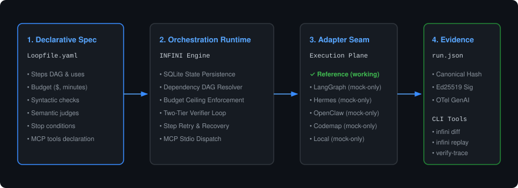

<picture>
  <source media="(prefers-color-scheme: dark)" srcset="assets/logo-dark.png">
  <source media="(prefers-color-scheme: light)" srcset="assets/logo-light.png">
  
</picture>

# INFINI — Portable Agent Workflow Spec & CLI

**What can you do with INFINI that you cannot do with a normal agent framework?**  
**Run the exact same agent workflow across multiple execution engines, verify outputs against real constraints, and diff standardized execution traces to see precisely where runtimes diverge.**

[](https://github.com/NickAiNYC/infini/actions)
[](docs/conformance.md)
[](pyproject.toml)
[](LICENSE)

---

## The Problem: Runtime Lock-In & Unverifiable Traces

Every modern agent runtime (LangGraph, CrewAI, AutoGen, custom orchestration) forces you to hardcode control flow, state schemas, and verification into proprietary code. If you want to evaluate an alternative engine or compare how two runtimes execute the exact same task, you have to rewrite the workflow from scratch and parse incompatible log dumps.

**INFINI solves this by separating the workflow specification from the runtime engine.**
1. You declare the workflow once in a portable `Loopfile.yaml`.
2. Any conforming engine executes the workflow and produces a structured trace (`run.json`).
3. You diff traces across engines to find divergences in step ordering, latency, costs, or check failures.

<p align="center">
  
</p>

---

## ⚡ 60-Second Quick Start

Zero-configuration quick start. Requires Python 3.11+. Succeeds on a clean clone in under 60 seconds with no API keys or external services:

```bash
# 1. Clone & install in a fresh virtualenv
git clone https://github.com/NickAiNYC/infini.git
cd infini
python3.11 -m venv venv
source venv/bin/activate
pip install -e .

# 2. Run the automated walkthrough in one command:
./demo.sh

# Or step-by-step:
infini run examples/quickstart.yaml      # Execute workflow
infini inspect runs/latest/              # Inspect execution trace
infini replay runs/latest/ --step s1     # Time-travel replay
```

Every run emits a structured `run.json` recording every step, cost, token count, and verification check.

---

## 🎬 60-Second Demo

Terminal walkthrough demonstrating: `run` $\rightarrow$ `inspect` $\rightarrow$ `replay --step` $\rightarrow$ `diff` across two engines:

```text
# 1. Execute on Reference engine
$ infini run examples/quickstart.yaml -o runs/reference
▶ engine: infini-reference (mock)
  ✓ s1 analyze  $0.01 · 0.6m
▶ verification:
  ✓ report.md:exists
  ✓ judge:summary_quality>=80 (conf 82.0)
✓ shipped. trace: runs/reference/run.json

# 2. Inspect trace table
$ infini inspect runs/reference/
╭──────────────────────────────────────────────────────────────────╮
│ quickstart  ·  engine: infini-reference  ·  outcome: verified     │
╰──────────────────────────────────────────────────────────────────╯
Steps:
  ✓ s1 analyze | ok | $0.01 | 0.6m | report.md

# 3. Replay from a specific step (deterministic cache)
$ infini replay runs/reference/ --step s1
▶ replay quickstart from step s1
  ✓ s1 analyze
✓ replay complete

# 4. Execute on LangGraph engine and diff execution traces
$ infini run examples/quickstart.yaml --engine langgraph -o runs/langgraph
$ infini diff runs/reference/run.json runs/langgraph/run.json

INFINI diff — Traces
  v1: runs/reference/run.json
  v2: runs/langgraph/run.json

Metric        v1          v2       Delta
Outcome       verified    verified
Iterations    2           1
Steps         2           1
Cost          $0.02       $0.01    -$0.01

⚡ First Step Divergence:
  Step: s1 (index 1)
  Detail: Step count mismatch: v1 executed extra step 's1' (analyze)
```

*(Raw terminal recording session archived in [`assets/demo.cast`](assets/demo.cast) for asciinema playback.)*

---

## 📊 Measured Benchmark Results

Measured locally via the reproducible benchmark suite (`make bench` / `benchmarks/run_benchmarks.py`). All results committed with hardware environment details in [`benchmarks/results.json`](benchmarks/results.json):

| Metric | Measured Result | Benchmark Methodology |
| :--- | :---: | :--- |
| **Replay Determinism** | **100.0%** (100/100) | $N=100$ replays of canonical workflow trace with cached model responses; asserts % byte-identical canonical payloads. |
| **Per-Step Overhead (Mean)** | **1.846 ms** | Reference engine dispatch, DAG resolution, and step recording latency per step ($N=100$ samples). |
| **Per-Step Overhead (P50)** | **1.819 ms** | Median step overhead. |
| **Per-Step Overhead (P95)** | **2.008 ms** | 95th percentile step overhead. |
| **Per-Step Overhead (Min / Max)**| **1.667 ms / 2.520 ms** | Bounds across 100 benchmark iterations. |
| **Machine Specification** | Apple M4 · 16 GB RAM | macOS Darwin 27.2.0 · Python 3.11.16 |

Reproduce locally anytime:
```bash
make bench
```

---

## Honest Adapter & Engine Status

Every adapter in INFINI has exactly one honest status:
- **`working`**: Fully implemented end-to-end (mock and/or live execution, verification, trace generation).
- **`mock-only`**: Implements specification parsing, step translation, and mock execution with structured trace emission; live framework execution is not yet wired.
- **`not built`**: Manifest or stub only; CLI explicitly fails with a descriptive "not implemented" error.

| Engine / Adapter | Status | Type | Capabilities & Coverage |
| :--- | :---: | :--- | :--- |
| **Reference (`infini`)** | `working` | Built-in Engine | Canonical spec runtime. Mock and live execution, syntactic & semantic verification, time-travel replay, trace diff. |
| **LangGraph** | `mock-only` | Execution Adapter | StateGraph step mapping, mock execution, structured trace generation. Live LangGraph runtime execution not yet wired. |
| **Hermes** | `mock-only` | Governance Adapter | Policy verification and governance checks. 70.8% compatibility score (see [docs/scoring.md](docs/scoring.md)). |
| **OpenClaw** | `mock-only` | Execution Adapter | Agent step execution and tool manifests. 66.7% compatibility score (see [docs/scoring.md](docs/scoring.md)). |
| **Codemap** | `mock-only` | Context Adapter | Context-aware step routing and handoff artifact tracking. |
| **Local (llama.cpp)** | `mock-only` | Offline LLM | Trace simulation; live execution requires external llama.cpp binary and local model weights. |
| **CrewAI** | `not built` | Execution Adapter | Manifest only (`adapters/crewai/adapter.yaml`). CLI rejects with `not implemented`. |
| **AutoGen** | `not built` | Multi-Agent | Planned community adapter manifest (`adapters/`). CLI rejects with `not implemented`. |
| **Mastra** | `not built` | TypeScript | Planned community adapter manifest. CLI rejects with `not implemented`. |
| **Goose** | `not built` | Developer Agent | Planned community adapter manifest. CLI rejects with `not implemented`. |
| **OpenAI Agents SDK** | `not built` | Execution Adapter | Planned community adapter manifest (`adapters/codex/`). CLI rejects with `not implemented`. |

*(Note: Exploratory ideas like on-chain escrow payments, 50+ agent micro-benchmarks, and 3D graph UIs are archived in [docs/ideas.md](docs/ideas.md) until backed by reproducible benchmarks.)*

---

## 🎯 Conformance Suite

INFINI includes an automated conformance test suite in `tests/conformance/`. Every test verifies a specific engine capability:

| Test Name | Directory | Asserted Guarantee |
| :--- | :--- | :--- |
| **`simple-loop`** | [`tests/conformance/simple-loop/`](tests/conformance/simple-loop/) | Basic 1-step workflow parse, deterministic run, and artifact existence check. |
| **`retry-loop`** | [`tests/conformance/retry-loop/`](tests/conformance/retry-loop/) | Transient step failure handling and exponential backoff retry caps. |
| **`verification-loop`** | [`tests/conformance/verification-loop/`](tests/conformance/verification-loop/) | Two-tier verification: syntactic checks + semantic judge checks with confidence thresholds. |
| **`cost-loop`** | [`tests/conformance/cost-loop/`](tests/conformance/cost-loop/) | Budget enforcement: execution terminates when dollar or wall-clock minute caps are reached. |
| **`memory-loop`** | [`tests/conformance/memory-loop/`](tests/conformance/memory-loop/) | State persistence and lessons-learned accumulation across loop iterations. |
| **`parallel-loop`** | [`tests/conformance/parallel-loop/`](tests/conformance/parallel-loop/) | DAG step resolution across parallel workers via `depends_on`. |
| **`research-loop`** | [`tests/conformance/research-loop/`](tests/conformance/research-loop/) | Multi-step research pipeline with cross-step artifact handoffs. |
| **`browser-loop`** | [`tests/conformance/browser-loop/`](tests/conformance/browser-loop/) | Simulated tool execution, parameter parsing, and trace emission. |

Run all 8 tests:
```bash
infini conformance tests/conformance/ --mock
```

To certify an adapter and compute its official compatibility score:
```bash
infini certify adapters/hermes --mock
```
Compatibility scores (e.g. Hermes 70.8%, OpenClaw 66.7%) are computed as:
$$\text{Compatibility} = \left(\frac{\text{Supported Capabilities}}{12}\times 50\right) + \left(\frac{\text{Passed Conformance Tests}}{8}\times 50\right)$$
See [`docs/scoring.md`](docs/scoring.md) and [`docs/conformance.md`](docs/conformance.md) for full derivations.

---

## 🔭 OpenTelemetry GenAI Semantic Conventions Export

Every execution trace can be exported directly into OpenTelemetry format following the OpenTelemetry GenAI Semantic Conventions:

```bash
# Option A: Export directly during workflow execution
infini run examples/quickstart.yaml --otel

# Option B: Export an existing run.json trace
infini export-otel runs/latest/run.json -o otel-trace.json
```

**Spec Status Note:**
- **Stable attributes:** `traceId`, `spanId`, `parentSpanId`, `name`, `kind` (`SPAN_KIND_INTERNAL`), `startTimeUnixNano`, `endTimeUnixNano`, `status.code`.
- **Experimental GenAI attributes (v1.27+ Draft):** `gen_ai.system` ("infini"), `gen_ai.workflow.name`, `gen_ai.workflow.outcome`, `gen_ai.operation.name`, `gen_ai.request.model`, `gen_ai.usage.input_tokens`, `gen_ai.usage.output_tokens`.

---

## 🔐 Offline Cryptographic Trace Signing (Ed25519)

Sign run traces locally using pure-Python RFC 8032 Ed25519 (zero external dependencies). Generates tamper-proof run artifacts for auditability:

```bash
# 1. Run and sign trace hash
infini run examples/quickstart.yaml --sign

# 2. Verify trace signature offline
infini verify-trace runs/latest/run.json
```

If any step, outcome, or token cost is tampered with, verification fails immediately. See [`docs/signing.md`](docs/signing.md) for the specification and external verifier interface.

---

## Project Readiness Audit

Audit your codebase for agent workflow readiness:
```bash
infini audit .
```
Evaluates 12 infrastructure signals (Loopfile, state tracking, verifiers, safety docs, CI workflows) and prints the exact score and formula.

---

## Status & Roadmap

Consolidated from historical status documents.

### Current Implementation Status (v0.2.0)
- **Core CLI & Spec Parser:** Stable. Schema validation against JSON Schema.
- **Reference Engine:** Working. Deterministic mock engine, budget enforcement, syntactic file checks, semantic judge checks, and time-travel replay.
- **Adapters:** 1 reference engine working (`infini`), 5 mock-only adapters (`langgraph`, `hermes`, `openclaw`, `codemap`, `local`), 5 not built (`crewai`, `autogen`, `mastra`, `goose`, `openai-agents`).
- **Observability:** OpenTelemetry GenAI semantic conventions exporter + step-level divergence diffing.
- **Integrity:** Local Ed25519 trace signing and offline verification.
- **Memory & Storage:** Embedded SQLite with FTS5 for local run memory and state persistence.
- **Conformance Suite:** 8/8 tests passing (`tests/conformance/`).

### Active Roadmap
1. **Live External Runtime Adapters:** Upgrading `langgraph` adapter from mock-only to live execution via LangGraph Python SDK.
2. **Containerized Verifiers:** Isolated Docker/sandbox execution for syntactic bash/file checks.
3. **Automated Trace Diff Comments:** CI bot that comments trace divergence tables directly on pull requests.

---

## Honest Limitations

1. **Mock-first ecosystem:** Outside the reference engine, adapter execution is currently `mock-only` (simulates steps and validates Loopfile translation) rather than driving live third-party runtime graphs.
2. **Single-node runtime:** The orchestration engine runs as a single local process using embedded SQLite. There is no distributed coordinator or multi-tenant isolation.
3. **Syntactic file checks:** Real filesystem checks (`file:exists`, `file:valid_json`) run within the local process working directory; containerized sandboxing is not yet implemented.

---

## Development & Verification Commands

```bash
# Run unit tests (35 passing)
python -m pytest cli/tests/ -v

# Run conformance suite (8/8 passing)
infini conformance tests/conformance/ --mock

# Run adapter certifications
infini certify adapters/hermes --mock
infini certify adapters/openclaw --mock

# Run reproducible benchmarks
make bench
```

[Contributing Guide](CONTRIBUTING.md) · [Scoring Methodology](docs/scoring.md) · [Conformance Suite](docs/conformance.md) · [Cryptographic Signing](docs/signing.md) · [Ideas Archive](docs/ideas.md) · [License: MIT](LICENSE)
